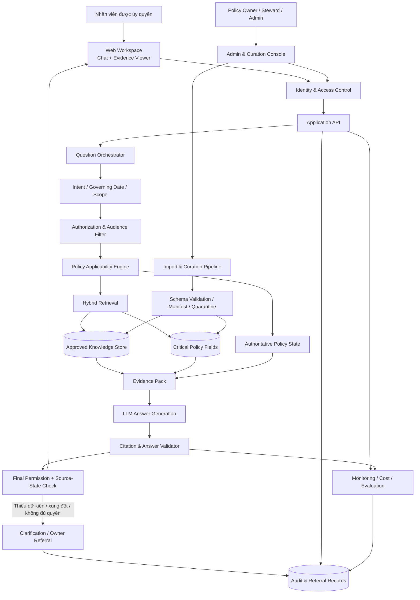
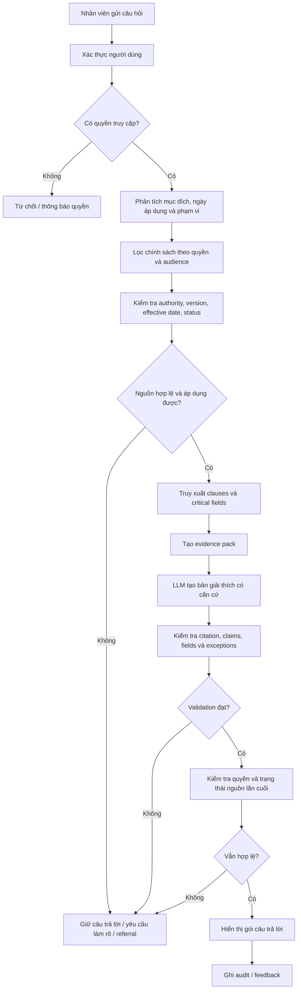
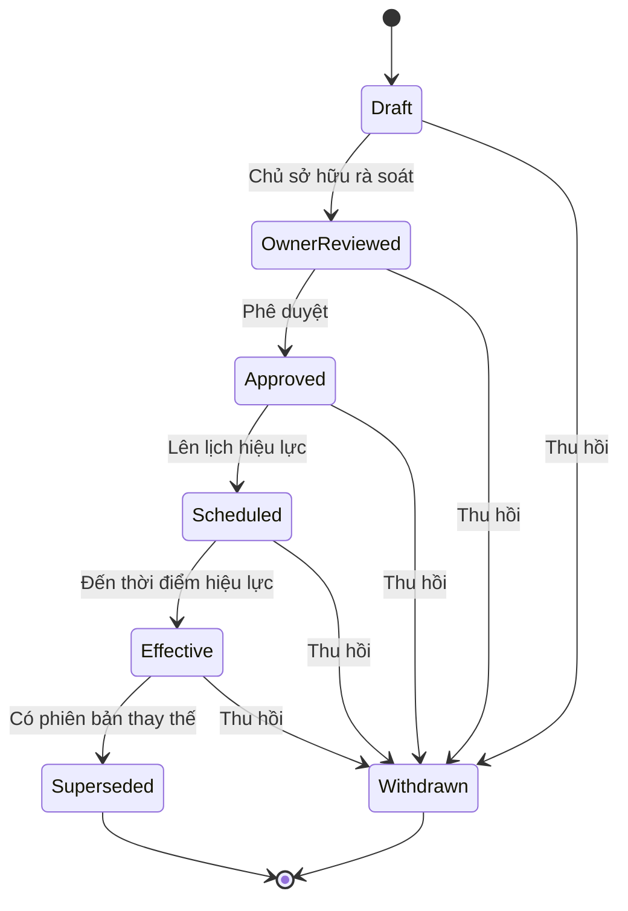
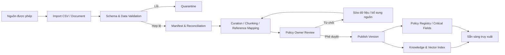
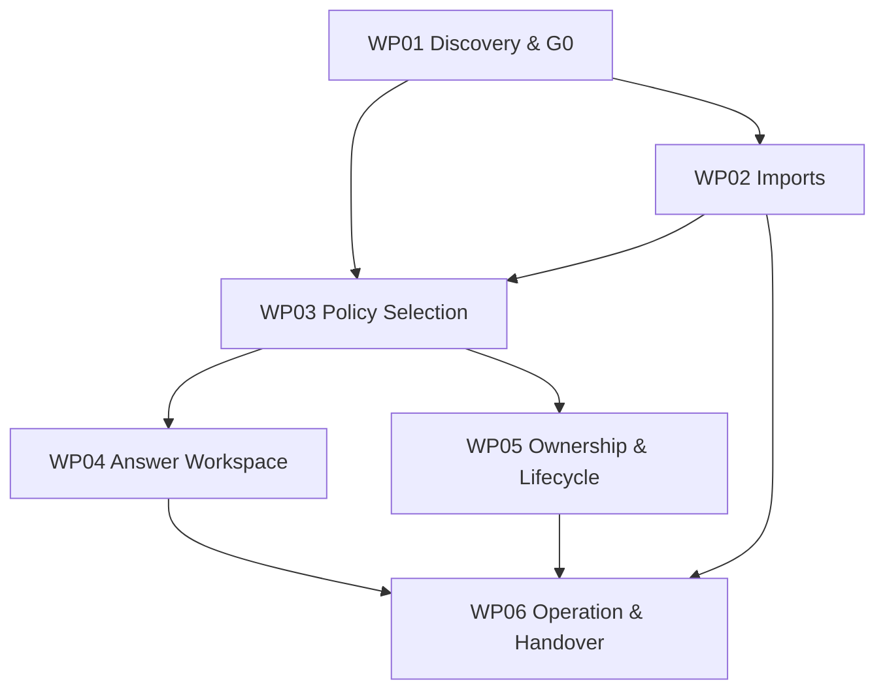
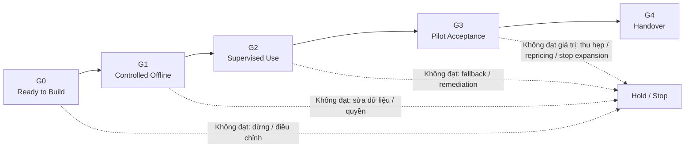
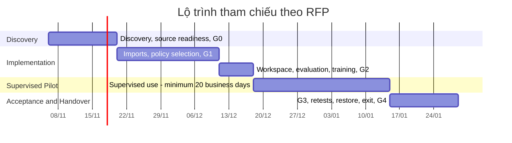
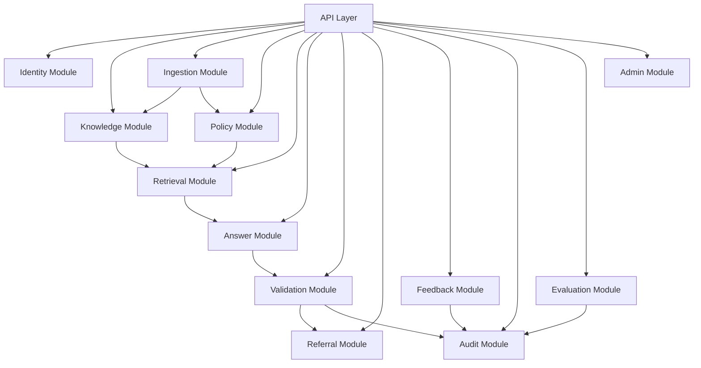
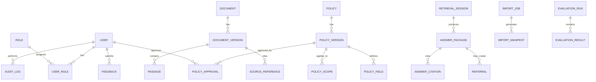
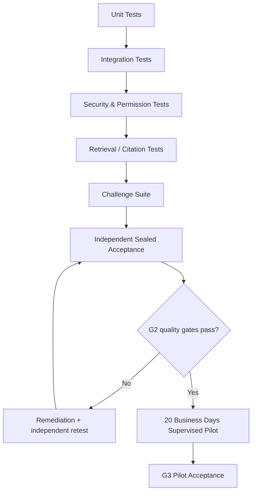

# SongNhat CRM Knowledge & Policy Assistant


> **README tổng quan dự án**<br>
> Phiên bản: 1.0 · Ngày cập nhật: 14/11/2026<br>
> Cơ sở nghiệp vụ: *SongNhat – CRM Knowledge and Policy Assistant RFP*<br>
> Trạng thái: Tài liệu định hướng dự án; các giả định và quyết định kỹ thuật cần được xác nhận tại các Release Gate tương ứng.

## Tài liệu liên quan

- [Kiến trúc tổng thể](docs/architecture-overview.md)
- [Playbook nhóm](docs/team-playbook.md)
- [Hướng dẫn Jira](docs/jira-playbook.md)
- [Quy trình nghiệp vụ dành cho Developer](docs/work-packages/04-developer-business-workflows.csv)
- [Kế hoạch Jira](docs/work-packages/03-project-planning-jira.csv)

---

## 1. Giới thiệu dự án

**SongNhat CRM Knowledge & Policy Assistant** là trợ lý tri thức và chính sách nội bộ dành cho nhân viên được ủy quyền. Hệ thống hỗ trợ tra cứu quy trình CRM đã được phê duyệt, xác định chính sách/phiên bản áp dụng, giải thích thông tin cần thiết, vai trò phê duyệt và cung cấp trích dẫn chính xác đến điều khoản nguồn.

Mục tiêu là giảm thời gian tìm kiếm lặp lại, hạn chế giải thích không nhất quán và giúp nhân viên tìm đúng phiên bản quy trình. Hệ thống cung cấp **hướng dẫn nội bộ có căn cứ**, không thay thế người có thẩm quyền, không tự phê duyệt giao dịch và không thực thi nghiệp vụ thay cho các hệ thống hiện hữu.

### 1.1 Mục tiêu chính

- Tập trung hóa tri thức từ tài liệu/quy trình đã được phê duyệt.
- Tìm kiếm và trả lời câu hỏi bằng tiếng Việt, có dẫn chứng tới điều khoản gốc.
- Xác định đúng phạm vi, ngày hiệu lực, trạng thái và thẩm quyền của chính sách.
- Hiển thị các trường dữ liệu quan trọng một cách có cấu trúc, không để mô hình tự suy đoán.
- Phát hiện dữ kiện còn thiếu hoặc mâu thuẫn và chuyển người dùng đến chủ sở hữu chính sách.
- Hỗ trợ quản lý vòng đời chính sách, kiểm toán, đánh giá chất lượng, khôi phục và bàn giao.

### 1.2 Ba nhóm chính sách dự kiến

Các nhóm dưới đây là **đề xuất ban đầu trong RFP và phải được xác nhận tại G0**:

| Nhóm | Phạm vi hỗ trợ | Giới hạn |
|---|---|---|
| Báo giá và phê duyệt thương mại | Thông tin cần có, quy trình và tuyến xử lý ngoại lệ thương mại | Không tự cấp ngoại lệ hoặc phê duyệt báo giá |
| Xử lý thông tin khách hàng | Hướng dẫn quy trình ghi nhận, chỉnh sửa, xác minh thông tin | Không tự tiết lộ dữ liệu hoặc kết luận căn cứ pháp lý |
| Dịch vụ và bảo hành | Xác định tài liệu cần thiết, tuyến chuyển tiếp và chủ sở hữu xử lý | Không tự quyết định quyền lợi bảo hành hoặc hướng dẫn sửa chữa thiết bị |

---

## 2. Phạm vi dự án

### 2.1 Phạm vi cơ sở (Base Scope)

- Tài liệu/quy trình được phê duyệt và các điều khoản nguồn.
- Các trường chính sách quan trọng được cấu trúc hóa.
- Quản lý phiên bản, chủ sở hữu, quyền truy cập, phạm vi và ngày hiệu lực.
- Tra cứu tiếng Việt và trả lời có trích dẫn.
- Làm rõ dữ kiện còn thiếu, giữ câu trả lời khi có xung đột và chuyển chủ sở hữu xử lý.
- Kiểm toán, đánh giá, phản hồi, vận hành, khôi phục và bàn giao.
- Hai định dạng CSV UTF-8 cơ sở: dữ liệu đoạn nội dung đã duyệt và dữ liệu trường chính sách quan trọng.

**Base Scope không nhập hồ sơ khách hàng.**

### 2.2 Tùy chọn O1 – Selected CRM Context

O1 là phạm vi **tùy chọn, phải báo giá riêng**. Chỉ xem xét bật khi đã xác minh nhu cầu, danh tính, quyền truy cập, mục đích xử lý hợp lệ, quyền dữ liệu và giá trị tăng thêm.

- Chỉ lấy một bản ghi nhân viên được phép lựa chọn từ snapshot có kiểm soát.
- Dữ liệu tham chiếu trong RFP: tối đa 2.000 dòng ban đầu và 5.000 dòng lưu giữ; phải xác nhận khi discovery.
- Có schema/validator thứ ba riêng.
- Không mặc định kết nối CRM trực tiếp.

### 2.3 Ngoài phạm vi mặc định

Các hạng mục sau không được tự động xem là một phần của pilot cơ sở; cần phạm vi, báo giá, quyền và kiểm thử riêng:

- Kết nối CRM hoặc repository trực tiếp.
- OCR, âm thanh, kênh Zalo/mailbox hoặc đọc tự động bảng chính sách.
- Thêm ngôn ngữ hoặc nhóm chính sách ngoài phạm vi đã thống nhất.
- Soạn phản hồi hướng ra khách hàng.
- Ghi dữ liệu ngược (writeback), tạo tác vụ CRM hoặc tự động phê duyệt.
- Tự động thực thi giao dịch hay quyết định quyền lợi.

---

## 3. Kiến trúc tổng thể

> Sơ đồ dưới đây là **kiến trúc đề xuất để triển khai**, không phải yêu cầu bắt buộc về nhà cung cấp, framework, mô hình AI hoặc workflow engine. RFP cho phép đánh giá giải pháp cấu hình sẵn hoặc phát triển riêng trên cùng bộ tiêu chí.

### 3.1 Sơ đồ kiến trúc logic



### 3.2 Các lớp chức năng

| Lớp | Trách nhiệm |
|---|---|
| Presentation | Giao diện hỏi đáp, hiển thị trích dẫn, trạng thái nguồn và trường chính sách |
| Identity & Access | Xác thực, vai trò, quyền theo đối tượng và phạm vi chính sách |
| Ingestion & Curation | Nhập CSV/tài liệu, kiểm tra schema, manifest, quarantine, duyệt nội dung |
| Policy Control | Trạng thái chính sách, phiên bản, ngày hiệu lực, phạm vi, thẩm quyền, ngoại lệ |
| Retrieval | Tìm kiếm nội dung được phép, lọc theo quyền/ngày/phạm vi |
| Answer Generation | Diễn giải bằng tiếng Việt dựa trên evidence đã chọn |
| Validation | Kiểm tra citation, trường quan trọng, nội dung thiếu căn cứ và trạng thái nguồn |
| Referral & Feedback | Ghi nhận câu hỏi cần làm rõ, chuyển chủ sở hữu và phản hồi |
| Audit & Operations | Nhật ký, đo chi phí, đánh giá, backup/restore, incident và exit |

### 3.3 Nguyên tắc kiến trúc quan trọng

1. **Policy control nằm trong application logic**, không chỉ nằm trong prompt.
2. Kiểm tra quyền trước retrieval, generation và display.
3. Ngày hiệu lực, trạng thái nguồn và phạm vi phải được kiểm tra rõ ràng.
4. Tách biệt approval, retrieval, generation, validation và staff use.
5. Mô hình chỉ giải thích evidence được phép; không tự tạo thẩm quyền, miễn điều kiện hay thực thi hành động.
6. Không hiển thị câu trả lời hoàn chỉnh trước khi validation và kiểm tra cuối cùng thành công.
7. Nếu không xác minh được trạng thái nguồn hoặc quyền truy cập, hệ thống phải **fail closed**.
8. Bản trả lời lịch sử phải hiển thị rõ ngày và phiên bản; không trình bày như hướng dẫn hiện hành.

---

## 4. Luồng xử lý nghiệp vụ

### 4.1 Luồng hỏi đáp



### 4.2 Cấu trúc gói câu trả lời

Mỗi câu trả lời cần thể hiện:

1. Câu hỏi gốc.
2. Ngày áp dụng (governing date) và phạm vi.
3. Hướng dẫn trả lời.
4. Trích dẫn chính xác tới điều khoản nguồn.
5. Các trường chính sách quan trọng.
6. Dữ kiện còn thiếu hoặc giả định chưa được xác minh.
7. Tuyến chuyển chủ sở hữu nếu cần.

### 4.3 Điều kiện phải giữ câu trả lời hoặc chuyển tiếp

- Không tìm thấy nguồn được phê duyệt phù hợp.
- Không xác định được phiên bản/ngày hiệu lực.
- Có xung đột giữa các nguồn hoặc dữ kiện trọng yếu.
- Thiếu thông tin để xác định phạm vi áp dụng.
- Người dùng không có quyền xem nguồn hoặc dữ liệu.
- Nguồn đã bị thu hồi hoặc không thể xác minh trạng thái hiện hành.
- Câu trả lời có claim trọng yếu không có citation hợp lệ.

---

## 5. Vòng đời chính sách và quản trị tri thức

### 5.1 Policy lifecycle



**Lưu ý:** Chính sách ở trạng thái Scheduled không được coi là hiện hành trước thời điểm hiệu lực. Việc sửa, thu hồi hoặc thay đổi quyền phải được ghi vào authoritative state trước khi hệ thống xác nhận hoàn tất. Các câu trả lời bị ảnh hưởng phải được đánh dấu stale và yêu cầu truy vấn lại.

### 5.2 Quy trình nhập và xuất bản tri thức



### 5.3 Quy tắc dữ liệu và ngôn ngữ

- Hỗ trợ Unicode tiếng Việt, truy vấn thiếu dấu, từ vựng quy trình, viết tắt CRM và thuật ngữ sản phẩm tiếng Anh.
- Bảo toàn tên chính sách, mã, số tiền, ngày tháng, đơn vị, vai trò và phủ định.
- Không biến mẫu dịch chung thành quy định riêng của SongNhat nếu chưa được phê duyệt.
- Mỗi passage/field cần liên kết tới nguồn gốc và phiên bản tương ứng.
- Owner response và user feedback chỉ là **knowledge candidate**; không tự động sửa hoặc huấn luyện để thay đổi chính sách.

---

## 6. Gói công việc

RFP định nghĩa 6 gói công việc (WP). Các Epic trong Jira có thể chia nhỏ hơn, nhưng cần được đối chiếu với WP để theo dõi phạm vi và nghiệm thu.

| Work Package | Tên | Kết quả chính |
|---|---|---|
| WP01 | Discovery | Danh mục câu hỏi, baseline, quyền nguồn, authority/date matrix, ba nhóm chính sách, so sánh phương án và quyết định G0 |
| WP02 | Imports | Hai validator cơ sở, manifest, quarantine, version history và withdrawal; validator thứ ba chỉ cho O1 |
| WP03 | Selection | Lọc quyền, publication, effective date, scope; critical field lookup và conflict hold |
| WP04 | Workspace | Trả lời tiếng Việt có citation, original references, deterministic field display, clarification và local referral |
| WP05 | Ownership | Vai trò xuất bản, scheduled effect, change impact, feedback và controlled corrections |
| WP06 | Operation | Audit, cost meters, evaluation, recovery, training, deployment, exit và support |

### 6.1 Sơ đồ phụ thuộc giữa các gói công việc



---

## 7. Cổng phát hành và tiêu chí nghiệm thu

Dự án có **5 cổng phát hành: G0 đến G4**. Không gộp G3 và G4 thành một cổng.



| Gate | Tên | Bằng chứng bắt buộc |
|---|---|---|
| G0 | Ready to build | Xác nhận nhóm chính sách, sample đã duyệt, năng lực curation, quyền nguồn, authority, recurring tasks và so sánh phương án có giá |
| G1 | Controlled offline | Corpus và field rows đã duyệt; import reconcile; quyền, effective dates, conflicts và original references được xác minh |
| G2 | Supervised use | Quality/challenge gates độc lập đạt; không có critical defect; legal deployment review hoàn tất; owners được đào tạo; có fallback |
| G3 | Pilot acceptance | Chấp nhận pilot sau **20 ngày làm việc có giám sát**; có báo cáo effort, use và cost; quyết định mở rộng tách riêng |
| G4 | Handover | Restore, deletion và exit tests đạt; bàn giao tài liệu, code được đặt hàng, cấu hình, dữ liệu theo thỏa thuận và training |

### 7.1 Các ngưỡng chất lượng chính

Các ngưỡng dưới đây là mục tiêu nghiệm thu được nêu trong RFP, cần giữ nguyên khi lập test plan và báo cáo:

| Nhóm | Mục tiêu |
|---|---|
| Critical controls | 0 unauthorized disclosure; 0 fabricated critical field; 0 fabricated approval; 0 current answer dựa trên policy đã withdrawn hoặc chưa đến effective date |
| Version / scope / date | ≥95% đúng version, scope và governing date trên sealed answerable tasks |
| Citation support | ≥95% material claims có căn cứ từ clause áp dụng |
| Clause coverage | ≥90% required clauses/exceptions được đưa vào |
| Citation integrity | 0 fabricated citations |
| Retrieval | ≥90% retrieval recall@5 trên sealed subset có evidence được duyệt và áp dụng |
| Answer usefulness | ≥80% answerable tasks hữu ích với chỉnh sửa nhỏ |
| Unanswerable handling | ≤5% unanswerable tasks nhận câu trả lời materially unsupported |
| Supervised effort | Ít nhất 20 ngày làm việc; mục tiêu giảm 20% mean total staff effort với chất lượng audit bằng hoặc tốt hơn |

### 7.2 Bộ dữ liệu đánh giá

RFP đưa ra cơ sở kiểm thử:

- 200 tác vụ câu hỏi thực tế được phép sử dụng:
  - 60 development
  - 40 validation
  - 100 sealed acceptance
- 80 constructed challenges.
- Trong 80 challenges có 40 tình huống định hướng Việt Nam:
  - 10 tình huống ngôn ngữ.
  - 10 tình huống ngày tháng/phạm vi.
  - 10 tình huống ngưỡng/ngoại lệ.
  - 10 tình huống quyền/thu hồi.
- Developer không được tuning dựa trên sealed cases.

---

## 8. Kế hoạch triển khai tham chiếu

RFP mô tả kế hoạch 10 tuần như **mục tiêu lập kế hoạch**, phụ thuộc việc tái sử dụng thành phần sẵn có, tốc độ biên tập tri thức và thời gian phê duyệt. Đây không phải cam kết rằng mọi điều kiện đều chắc chắn hoàn thành trong 10 tuần.



**Quan trọng:** Thời gian sử dụng có giám sát tối thiểu là 20 ngày làm việc, không phải 20 ngày lịch. Ngày nghỉ/lễ hoặc lượng câu hỏi thấp có thể kéo dài thời gian quan sát. Không rút ngắn pilot để khớp lịch tổng.

### 8.1 Kế hoạch Sprint trong Jira

Sprint là cách nhóm tổ chức công việc nội bộ; cần đồng bộ với lịch được duyệt và không thay thế các cổng phát hành trong RFP.

| Sprint | Chủ đề dự kiến | Đầu ra |
|---|---|---|
| Sprint 0 | Discovery | Phạm vi, baseline, nguồn, owners, G0 |
| Sprint 1 | Offline knowledge & controls | Import, versioning, policy selection, quyền, G1 |
| Sprint 2 | Pilot readiness | Workspace, evaluation, challenges, training, G2 readiness |
| Sprint 3–4 | Supervised pilot | Vận hành có giám sát, đo effort/use/quality |
| Sau pilot | Acceptance & handover | G3, retest, restore/exit, training, G4 |

Ngày bắt đầu/kết thúc cụ thể phải lấy từ project plan/Jira đã được nhóm và sponsor xác nhận.

---

## 9. Bảo mật, quyền riêng tư và quản trị

### 9.1 Các nguyên tắc bắt buộc

- Dùng identity do tổ chức quản lý và least privilege.
- Kiểm tra quyền với policy audience và CRM context trước retrieval, generation và display.
- Base scope không nhập customer records; hướng dẫn nhân viên không đưa định danh khách hàng vào câu hỏi.
- Trước khi dùng dữ liệu thật, phải rà soát mục đích, căn cứ xử lý, thông báo, quyền chủ thể, vai trò, nhà cung cấp/subprocessor, đánh giá và chuyển dữ liệu.
- Xác định vị trí xử lý/lưu trữ của prompts, indexes, logs, backups và support.
- Không cho phép provider sử dụng dữ liệu trái phép để training/reuse; làm rõ retention, telemetry và deletion limits.
- Mã hóa khi truyền và khi lưu; quản lý secrets ngoài prompt; quét file nhập; vá dependencies.
- Tách môi trường test và production.
- Có incident process, change review, rollback và emergency disable.
- Việc áp dụng nghĩa vụ pháp lý cụ thể phải do legal owner xác nhận; README này không phải tư vấn pháp lý.

### 9.2 Critical incident

RFP xác định các lỗi nghiêm trọng gồm:

- Tiết lộ trái phép.
- Bịa đặt phê duyệt hoặc ngưỡng.
- Hiển thị chính sách đã withdrawn như chính sách hiện hành.

Khi xảy ra, cần disable đường xử lý bị ảnh hưởng và chuyển sang manual search/referral. Mục tiêu vận hành trong RFP: acknowledge production critical issue trong 2 covered hours và containment trong 4 covered hours, theo khung hỗ trợ đã thỏa thuận.

---

## 10. Vai trò và trách nhiệm

| Vai trò | Trách nhiệm chính |
|---|---|
| Purchaser Sponsor | Phạm vi, ngân sách, cổng phát hành và quyết định đầu tư |
| Policy Owner | Phê duyệt hierarchy, nội dung, authority, effective dates, exceptions và referral route |
| Knowledge/Data Steward | Chuẩn hóa nguồn, import, manifest, version mapping, quality và maintenance |
| Staff User | Đặt câu hỏi, kiểm tra evidence và xác minh tình huống thực tế trước hành động |
| Privacy/Security Owner | Identity, permissions, provider routes, privacy/security review, incident |
| Legal Owner | Xác nhận phân loại AI, nghĩa vụ pháp lý và tài liệu triển khai áp dụng |
| Supplier/Development Team | Thiết kế, xây dựng/cấu hình, kiểm thử, triển khai, tài liệu và bàn giao |
| Independent Evaluator | Đánh giá sealed tasks/challenges độc lập với nhóm đã tuning hệ thống |

### 10.1 RACI rút gọn

| Hoạt động | Sponsor | Policy Owner | Steward | Dev/Supplier | Security/Legal | Independent Evaluator |
|---|---|---|---|---|---|---|
| Chốt phạm vi/G0 | A | C | R | C | C | I |
| Duyệt nội dung chính sách | I | A | R | C | C | I |
| Import/curation | I | C | A/R | R | C | I |
| Policy logic & workspace | I | C | C | A/R | C | I |
| Security/legal review | I | C | C | R | A | I |
| Sealed acceptance | A | C | C | I | C | R |
| Handover/G4 | A | C | R | R | C | I |

> R = Responsible · A = Accountable · C = Consulted · I = Informed. Ma trận chi tiết cần được các bên xác nhận trước khi vận hành.

---

## 11. Công nghệ và cấu trúc mã nguồn

RFP không bắt buộc nhà cung cấp, mô hình, framework hay công cụ điều phối quy trình cụ thể. Repository hiện tổ chức backend theo kiến trúc **Modular Monolith + RAG + Policy Control Layer**. Bảng dưới phản ánh các manifest/cấu hình hiện có; không đồng nghĩa mọi chức năng đã hoàn thiện hoặc được duyệt dùng trong production.

### 11.1 Công nghệ hiện có trong repository

| Thành phần | Phiên bản/cấu hình hiện tại | Ghi chú |
|---|---|---|
| Frontend | Next.js 14, React 18, TypeScript 5 | Ứng dụng trong `frontend/` |
| Backend | Python 3.12+, FastAPI | API và các module nghiệp vụ trong `backend/` |
| Database | PostgreSQL 16, pgvector | Cấu hình trong `docker-compose.yml` |
| Tác vụ nền | Celery, Redis 7 | Worker nằm trong `worker/` |
| Lưu trữ tệp | MinIO, tương thích S3 | Dịch vụ tùy chọn qua Compose profile `storage` |
| Môi trường phát triển | Docker Compose | Cấu hình hiện tại dành cho phát triển, không dùng trực tiếp cho production |
| Mô hình AI | Cấu hình qua biến môi trường | Cần rà soát quyền riêng tư, lưu giữ và nhà cung cấp trước khi dùng dữ liệu thật |

### 11.2 Khởi chạy môi trường phát triển

Cần cài Docker Desktop với Docker Compose. Tạo tệp `.env` từ mẫu nếu chưa có; không ghi đè tệp `.env` hiện có vì tệp này có thể chứa cấu hình riêng:

```powershell
if (-not (Test-Path .env)) { Copy-Item .env.example .env }
```

Sau khi cập nhật cấu hình cần thiết trong `.env`, chạy toàn bộ dịch vụ ứng dụng:

```powershell
docker compose --profile app up --build
```

Mặc định lệnh trên khởi động PostgreSQL, Redis, backend, worker, frontend và Nginx. Các địa chỉ phát triển:

| Dịch vụ | Địa chỉ |
|---|---|
| Giao diện | `http://localhost:3000` |
| Backend health check | `http://localhost:8000/health` |
| Tài liệu API (môi trường phát triển) | `http://localhost:8000/docs` |
| Nginx | `http://localhost` |

MinIO không được bật cùng profile `app`. Nếu cần thử lưu trữ tệp, khởi động riêng bằng `docker compose --profile storage up -d storage`. Không dùng các mật khẩu mặc định trong cấu hình phát triển cho môi trường production; không commit `.env` hoặc secret.

### 11.3 Sơ đồ module backend



### 11.4 Cấu trúc repository hiện tại

```text
crm-knowledge-and-policy-assistant/
├── backend/
│   ├── src/modules/       # Các module API và nghiệp vụ
│   ├── migrations/        # Migration cơ sở dữ liệu
│   └── tests/
├── frontend/
│   └── src/app/           # Các trang Next.js
├── worker/
│   └── src/tasks/         # Tác vụ nền Celery
├── data/
│   ├── sample/
│   └── templates/
├── docs/
│   └── work-packages/
├── infra/
│   ├── db/
│   └── nginx/
├── docker-compose.yml
└── Makefile
```

Đây là cấu trúc cấp cao của repository hiện tại; các thư mục và module có thể thay đổi theo tiến độ triển khai.

---

## 12. Mô hình dữ liệu khái niệm

Các nhóm thực thể gợi ý để quản lý dữ liệu và truy vết. Schema cuối cùng cần được chốt trong thiết kế chi tiết.



### 12.1 Nhóm dữ liệu chính

- **Identity:** users, roles, permissions, user_roles.
- **Knowledge:** documents, document_versions, passages, source_references.
- **Policy:** policies, policy_versions, policy_scopes, policy_fields, policy_approvals.
- **AI/Retrieval:** embeddings, retrieval_sessions, answer_packages, answer_citations.
- **Operations:** import_jobs, import_manifests, audit_logs, feedback, referrals, evaluation_runs.

---

## 13. Kiểm thử và đảm bảo chất lượng

### 13.1 Các tầng kiểm thử



### 13.2 Các tình huống bắt buộc phải có trong test suite

- Câu hỏi hiện tại, câu hỏi lịch sử và chính sách tương lai chưa đến ngày hiệu lực.
- Chính sách bị superseded hoặc withdrawn.
- Ranh giới chính xác của ngưỡng và ngoại lệ.
- Thiếu dữ kiện hoặc có mâu thuẫn giữa các nguồn.
- Hợp đồng/ghi chú CRM không được tự động ưu tiên hơn chính sách đã công bố.
- Người dùng không có quyền nhưng thử mở link, citation, snippet, cache, log hoặc download.
- Thu hồi chính sách trong lúc generation đang chạy.
- Câu hỏi tiếng Việt thiếu dấu, viết tắt CRM, trộn thuật ngữ tiếng Anh.
- Số tiền, ngày tháng, đơn vị, vai trò và phủ định.
- Citation sai, thiếu clause hoặc claim không có evidence.
- Snapshot cũ, import lỗi, manifest reconcile không khớp.
- Fallback khi không xác minh được trạng thái quyền hoặc nguồn.

---

## 14. Quản lý dự án và quy ước làm việc

### 14.1 Jira

Dùng Jira để quản lý:

- Epic / Story / Task / Bug / Spike.
- Summary, Description và Acceptance Criteria.
- Assignee, Reporter, Priority, Status, Sprint.
- Start Date, Due Date, Estimate, Time Spent, Remaining Estimate.
- Labels, Components, Fix Version.
- Parent/Epic Link và issue links/dependencies.
- Release Gate, Work Package và bằng chứng nghiệm thu (có thể dùng custom fields/labels theo cấu hình Jira).

Mỗi Story/Task quan trọng nên có Acceptance Criteria kiểm thử được. Không chuyển Done nếu thiếu bằng chứng hoàn thành hoặc review theo Definition of Done của nhóm.

### 14.2 Git

Quy ước đề xuất:

- `main`: nhánh ổn định.
- `develop`: nhánh tích hợp nếu nhóm chọn GitFlow.
- `feature/<issue-key>-short-description`
- `fix/<issue-key>-short-description`
- `docs/<issue-key>-short-description`

Commit message tham khảo:

```text
feat(policy): add effective date validation
fix(retrieval): block withdrawn policy passages
docs(readme): update project overview
test(answer): add citation validation cases
```

Mỗi Pull Request cần liên kết Jira issue, mô tả thay đổi, test evidence và reviewer. Không commit secrets, dữ liệu khách hàng hoặc tài liệu nội bộ không được phép.

---

## 15. Rủi ro và giả định cần xác minh

| Rủi ro / giả định | Tác động | Hướng xử lý |
|---|---|---|
| Chưa có policy owner hoặc quyền nguồn rõ ràng | Không thể xác định nguồn có thẩm quyền | Chốt owner, substitute, authority và rights trước G0 |
| Tài liệu thiếu ngày hiệu lực/phiên bản | Trả lời sai chính sách hiện hành | Chuẩn hóa metadata và giữ trạng thái nguồn |
| Curation capacity không đủ | Chậm G1, chất lượng retrieval kém | Đo effort và cam kết nguồn lực ở G0 |
| Thiếu recurring tasks hoặc baseline | Không chứng minh được giá trị | Quan sát công việc thực tế và đo effort |
| Dữ liệu cá nhân lọt vào câu hỏi | Rủi ro quyền riêng tư | Data minimization, hướng dẫn và test |
| Provider xử lý dữ liệu ngoài phạm vi | Rủi ro pháp lý/vận hành | Review location, subprocessors, retention và transfer |
| Mô hình bịa citation hoặc critical fields | Rủi ro nghiêm trọng | Validator, deterministic fields, challenge suite và hold |
| Withdraw không chặn câu trả lời đang chạy | Hiển thị policy không còn hiệu lực | Final state check và fail-closed |
| Giá trị đầu tư chưa được chứng minh | Mở rộng không hiệu quả | Đo full cost và so sánh phương án trước expansion |
| Phụ thuộc O1 bị hiểu nhầm là base | Phình phạm vi và tăng rủi ro | Tách option, quyền, giá và acceptance riêng |

### 15.1 Giả định quy mô trong RFP

Các con số sau là **common bid assumptions**, không phải số liệu vận hành đã xác nhận:

- Một công ty SongNhat.
- 20 người dùng được định danh; 5 phiên đồng thời.
- Tối đa 30 tài liệu được duyệt, 300 passages đã curate, 50 critical field rows trên ba nhóm chính sách.
- Hai schema CSV cơ sở.
- Một batch/ngày/schema đang hoạt động, tối đa 500 dòng thay đổi/ngày.
- O1: tối đa 2.000 dòng ban đầu và 5.000 dòng lưu giữ.
- Xác nhận độ phù hợp thực tế tại G0; không tạo quy tắc chỉ để đạt trần số lượng.

---

## 16. Định nghĩa hoàn thành (Definition of Done)

Một hạng mục chỉ được xem là hoàn thành khi đáp ứng các điều kiện áp dụng:

- Có Jira issue và phạm vi rõ ràng.
- Acceptance Criteria có thể kiểm chứng.
- Code/configuration được review.
- Unit/integration/security tests phù hợp đã chạy.
- Không có critical defect chưa xử lý.
- Tài liệu và cấu hình liên quan được cập nhật.
- Không lộ secrets hoặc dữ liệu không được phép.
- Có evidence (test report, screenshot/log đã làm sạch, link PR hoặc biên bản owner approval).
- Thay đổi policy/content có owner approval và version/effective date phù hợp.
- Các thay đổi ảnh hưởng release gate đã được đánh giá và retest.

---

## 17. Tài liệu trong repository

Các tài liệu dự án hiện có:

| Tài liệu | Nội dung |
|---|---|
| [Tổng quan kiến trúc](docs/architecture-overview.md) | Module, luồng hỏi đáp và nguyên tắc kiến trúc |
| [Playbook nhóm](docs/team-playbook.md) | Vai trò, quy trình phối hợp và cổng kiểm soát |
| [Hướng dẫn Jira](docs/jira-playbook.md) | Cấu trúc issue và quy tắc sử dụng Jira |
| [Playbook Git](docs/git-playbook.md) | Nhánh, commit, pull request và review |
| [Quy trình nghiệp vụ cho Developer](docs/work-packages/04-developer-business-workflows.csv) | Luồng nghiệp vụ và phần việc triển khai tương ứng |
| [Kế hoạch Jira](docs/work-packages/03-project-planning-jira.csv) | Epic, Story, Task, timeline và tiêu chí nghiệm thu |

---

## 18. Nguyên tắc cốt lõi cần nhớ

1. **Đúng nguồn quan trọng hơn câu trả lời nghe có vẻ hợp lý.**
2. **Quyền, thẩm quyền, ngày hiệu lực và phạm vi phải được kiểm soát bằng logic hệ thống.**
3. **Không có evidence phù hợp thì phải hỏi lại hoặc chuyển owner, không đoán.**
4. **Assistant giải thích quy trình; con người và hệ thống có thẩm quyền mới phê duyệt/thực thi.**
5. **Không nhập customer records trong Base Scope. O1 phải được duyệt và định giá riêng.**
6. **G0–G4 là 5 release gates riêng biệt; pilot supervised use tối thiểu 20 ngày làm việc.**
7. **Chất lượng phải được chứng minh bằng test độc lập và sealed acceptance, không chỉ bằng demo.**
8. **Mở rộng chỉ sau khi có bằng chứng về nhu cầu, chất lượng, quyền và giá trị thực tế.**

---

## 19. Nguồn và thứ tự ưu tiên

Tài liệu này được xây dựng dựa trên RFP **SongNhat – CRM Knowledge and Policy Assistant** được cung cấp trong Project. Khi có khác biệt, áp dụng thứ tự ưu tiên tài liệu theo RFP:

1. Hợp đồng đã ký và các sửa đổi/phụ lục đã thực thi.
2. RFP và addenda được phát hành.
3. Offer được chấp thuận.

Các đề xuất kiến trúc, stack và cấu trúc repository trong README là gợi ý kỹ thuật để nhóm thảo luận; không thay thế yêu cầu hợp đồng/RFP và không được hiểu là quyết định đã được phê duyệt.

---

## 20. License / Usage

Tài liệu này là tài liệu nội bộ phục vụ đồ án/thực hiện dự án. Quyền sử dụng, phân phối mã nguồn, dữ liệu và tài liệu nghiệp vụ cần tuân theo thỏa thuận dự án và quyền của chủ sở hữu tương ứng.
