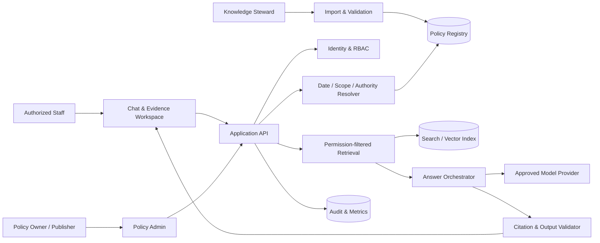
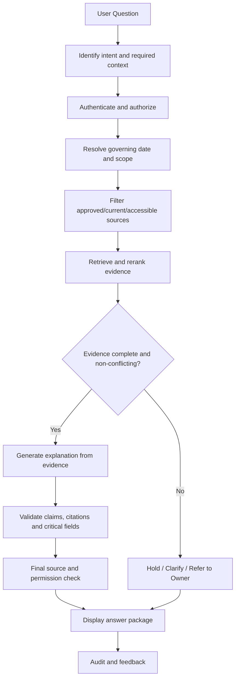

# 05. Technical Design – Thiết kế kỹ thuật

> **Phiên bản:** 0.1 – Proposed design, chưa phải quyết định cuối cùng.  
> **Nguyên tắc:** RFP không bắt buộc vendor, LLM, framework, database hay workflow engine cụ thể. Mọi stack dưới đây là đề xuất kỹ thuật cần PoC và ADR.

## 1. Design Principles

1. Authority, permissions, effective dates, source state và critical fields phải được kiểm soát bằng application logic ngoài LLM prompt.
2. LLM chỉ giải thích evidence đã được phép truy xuất; không tự chọn hierarchy, waive prerequisites hoặc execute actions.
3. Tách biệt approval, retrieval, generation, validation và staff use.
4. Mọi material claim cần exact applicable citation.
5. Không đủ căn cứ/conflict/withdrawal → hold, không đoán.
6. Base scope không truy cập customer records.
7. Chọn giải pháp ít phức tạp nhất đáp ứng yêu cầu; so sánh searchable library, configured product và bounded custom build.

## 2. Technology Stack – Proposal

| Layer | Đề xuất | Ghi chú |
|---|---|---|
| Language | Python 3.x | Phiên bản cụ thể pin trong dependency lock |
| Backend API | FastAPI | REST/OpenAPI |
| RAG orchestration | LlamaIndex hoặc LangChain, hoặc orchestration riêng | Chọn một sau PoC; không dùng framework chỉ vì phổ biến |
| LLM | API provider được thẩm định hoặc local model | Quyết định sau privacy/provider/cost/quality assessment |
| Embedding | Vietnamese-capable embedding model | Đánh giá trên corpus và câu hỏi thực tế |
| Reranker | Cross-encoder/reranker tùy kết quả | Đo recall@5 và latency |
| Database | PostgreSQL | Metadata, policy state, audit references |
| Vector search | pgvector hoặc search service phù hợp | Đánh giá filter và scale |
| Cache | Redis (optional) | Cache phải tôn trọng permission/version/withdrawal |
| Frontend | React + TypeScript; Next.js nếu cần | UI chatbot và evidence viewer |
| UI styling | Tailwind CSS (optional) | Chỉ là lựa chọn triển khai |
| Auth | OIDC/SSO nếu hệ thống hiện hữu hỗ trợ | Không tự giả định IdP |
| Container | Docker | Reproducible runtime |
| Reverse proxy | Nginx hoặc managed ingress | Theo môi trường triển khai |
| CI/CD | GitHub Actions | Lint, test, build, security checks |
| Testing | Pytest, API integration tests, Playwright (nếu phù hợp) | Chọn theo stack thực tế |
| Observability | Structured logs + metrics + traces | Không log secrets/PII không cần thiết |

### 2.1 API, Local hay Hybrid

**API-first** có thể giúp thử nghiệm nhanh, nhưng chỉ dùng sau khi đánh giá:
- Provider và subprocessors.
- Data location và cross-border transfers.
- Retention/training terms.
- Dữ liệu được gửi đi và mục đích xử lý.
- Access control, incident handling và cost caps.

**Local AI** cần PoC về GPU/CPU, latency, chất lượng tiếng Việt, vận hành, cập nhật model, bảo mật và tổng chi phí. Local hosting không tự chứng minh tuân thủ pháp luật.

**Hybrid** có thể tách dữ liệu nhạy cảm và workload, nhưng tăng độ phức tạp vận hành. Cần ADR riêng.

RFP không yêu cầu fine-tuning. “Chuẩn bị trước, trả lời sau” nên được hiểu là curate/approve source → validate metadata → index → evaluate → retrieve evidence → generate constrained explanation → validate → final permission/source check → display. Không đồng nghĩa bắt buộc huấn luyện lại model.

## 3. System Architecture

### 3.1 Architectural Style

**Đề xuất:** Modular Monolith cho phiên bản đầu, chia module rõ ràng trong một deployable backend. Không xây microservices sớm nếu chưa có nhu cầu scale/team boundary độc lập.

Layering đề xuất:
- Presentation/API layer.
- Application/use-case layer.
- Domain layer (policy, authority, applicability, lifecycle).
- Infrastructure layer (database, vector index, LLM provider, identity, storage).

### 3.2 Logical Components

1. Identity & Access Module.
2. Knowledge Import/Validation Module.
3. Policy Registry & Lifecycle Module.
4. Authority/Scope/Effective-Date Resolver.
5. Critical Field Registry.
6. Retrieval & Reranking Module.
7. Answer Orchestrator.
8. Citation/Evidence Validator.
9. Referral & Feedback Module.
10. Audit/Cost/Monitoring Module.
11. Admin/Publisher Workspace.

### 3.3 System Context



### 3.4 Data Flow – Answer



## 4. Answer Package Contract

Mỗi câu trả lời phải hiển thị:
- Câu hỏi.
- Governing date và scope.
- Guidance/explanatory wording.
- Exact clause citations và version.
- Structured critical fields.
- Missing facts/clarification.
- Referral route và uncertainty.

Không được coi câu trả lời là approval, customer promise, legal opinion hoặc execution.

## 5. Database Design – Logical Entities

Đây là logical proposal; schema vật lý cần ADR và review.

| Entity | Mục đích | Key fields gợi ý |
|---|---|---|
| users | Identity mapping | id, external_subject, status |
| roles / user_roles | RBAC | role_code, user_id |
| policy_families | Nhóm policy | family_id, name, owner_id |
| source_documents | Tài liệu gốc | document_id, title, original_ref, owner, approver |
| policy_versions | Phiên bản | version_id, document_id, version, status, published_at |
| passages | Đoạn đã curate | passage_id, version_id, text, section, page, language |
| policy_scopes | Phạm vi áp dụng | company, branch, role, category, product, transaction |
| effective_intervals | Thời gian hiệu lực | valid_from, valid_to, governing_date_rule |
| critical_fields | Trường cấu trúc | field_id, type, operator, value, unit, currency, clause_id |
| supersessions | Quan hệ thay thế | prior_version_id, successor_version_id |
| import_batches | Theo dõi import | batch_id, type, snapshot/increment, status |
| import_rows | Reconciliation | row_id, accepted/quarantined, reason |
| answer_tasks | Câu hỏi/answer task | task_id, user_id, question, date, scope |
| answer_evidence | Evidence được dùng | task_id, passage_id, version_id, citation |
| referrals | Chuyển owner | referral_id, issue, owner, status |
| feedback | Phản hồi | type, source, status |
| audit_events | Audit | actor, action, timestamp, target |
| usage_costs | Metering | attempt, tokens, provider, cost, status |

### 5.1 Data Rules

- Stable IDs; không dùng title làm khóa duy nhất.
- Phân biệt recorded time và effective time.
- Không ghi đè lịch sử version âm thầm.
- Mọi critical field liên kết clause/source/version.
- Không coi CRM note hoặc historical exception là policy chung.
- Index/cache phải bị vô hiệu hóa theo quyền, withdrawal và version state.
- Base scope không có customer-record entity/import.

### 5.2 Migration Strategy

- Migration version-controlled trong repository.
- Mỗi migration có forward path và rollback/recovery plan.
- Test migration trên sanitized test data.
- Backup trước migration có rủi ro.
- Không chạy migration production thủ công không có approval/log.

## 6. API Design – Proposal

REST API, version prefix `/api/v1`.

| Method | Endpoint | Purpose |
|---|---|---|
| POST | `/api/v1/questions` | Submit question |
| GET | `/api/v1/answers/{task_id}` | Retrieve answer package |
| POST | `/api/v1/referrals` | Create local referral |
| POST | `/api/v1/feedback` | Submit feedback |
| POST | `/api/v1/imports/passages` | Import passages |
| POST | `/api/v1/imports/critical-fields` | Import critical fields |
| GET | `/api/v1/policies` | Search/list accessible policies |
| GET | `/api/v1/policies/{id}/versions` | Version history |
| POST | `/api/v1/policies/{id}/withdrawal` | Authorized withdrawal |
| POST | `/api/v1/policies/{id}/publish` | Authorized publication |
| GET | `/api/v1/admin/imports/{batch_id}` | Reconciliation report |
| GET | `/api/v1/health` | Health check |

Endpoints chỉ là proposal; quyền và workflow phải được xác nhận trước implementation.

### 6.1 Request/Response conventions

- JSON, UTF-8.
- Stable error code, human-readable message, correlation/request ID.
- Validate input server-side.
- Pagination cho list endpoints.
- Idempotency key cho import/retry và thao tác phù hợp.
- Không trả stack trace, secret hoặc unauthorized source content.

Ví dụ error:

```json
{
  "error": {
    "code": "POLICY_EVIDENCE_CONFLICT",
    "message": "Không thể kết luận do nguồn chính sách có xung đột.",
    "request_id": "generated-correlation-id"
  }
}
```

## 7. Diagrams to Complete

- [ ] System Context Diagram (validate stakeholders/integrations).
- [ ] Component Diagram.
- [ ] Data Flow Diagram (answer, import, withdrawal).
- [ ] Deployment Diagram (chosen environment).
- [ ] ERD physical.
- [ ] Sequence Diagram for withdrawal during generation.

## 8. Architecture Decision Records

Tạo ADR cho:
- Modular monolith vs configured product.
- API vs local vs hybrid model.
- Embedding/reranker/model choice.
- PostgreSQL/pgvector vs external search.
- Identity provider and RBAC mapping.
- Hosting/data location.
- Cache and withdrawal invalidation.
- Logging/retention.
- Deployment and recovery.

## 9. Source Notes

RFP trang 5–8 (data authority, answer behavior, maintenance, architecture/work packages), trang 20–22 (worked cases, retention, operations), trang 25–28 (Vietnam privacy/AI/cybersecurity review and feasibility).
